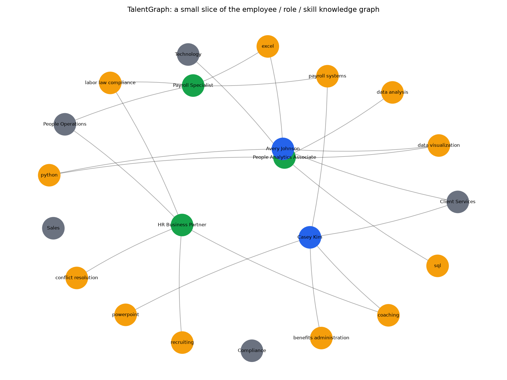

# TalentGraph

**An HR skill ontology and knowledge graph, a content-based internal-role recommender, a declarative eligibility rules engine, and a responsible-AI fairness audit — deployed behind a FastAPI service.**



*A small slice of the knowledge graph: employees (blue) connected to their skills (orange) and departments (gray), roles (green) connected to the skills they require. Rendered with `scripts/render_graph_preview.py`.*

## Why this exists

This targets a rotational AI internship's stated breadth directly: a semantic layer / knowledge graph / ontology, a recommender system, a rules engine, and responsible AI with bias mitigation are four distinct concepts named side by side in the role's own description of emerging AI trends and documentation expectations. Rather than build four disconnected toy demos, this project ties all four together around one coherent, original HR use case: given an employee's skills, recommend an internal role, check whether hard eligibility rules (experience, certification) actually allow the move, and audit whether the recommender's top picks are distributed fairly across a protected attribute.

All data (employees, roles, skills) is synthetic and fictional, generated for this project — no real people, real company, or real employer data is involved anywhere.

## Features

- **Knowledge graph / ontology** (`talentgraph/ontology.py`) — typed nodes (Employee, Role, Skill, Department) and typed edges (HAS_SKILL, REQUIRES_SKILL, BELONGS_TO) built with networkx, queryable in both directions (an employee's skills, or every employee who holds a given skill).
- **Skill extraction** (`talentgraph/skill_extraction.py`) — pulls known skills out of free-form text via exact phrase matching against the ontology's controlled vocabulary, with abbreviation expansion (PM, ML) and fuzzy matching for typos as a fallback.
- **Content-based recommender** (`talentgraph/recommender.py`) — ranks internal roles for an employee by Jaccard similarity between their skills and each role's required skills, reporting matched and missing skills.
- **Eligibility rules engine** (`talentgraph/rules_engine.py`) — a small set of named, independently testable rules (minimum experience, required certifications) run as a batch, separate from the similarity score, since a good content match is not the same as being allowed to move into the role today.
- **Responsible AI / fairness audit** (`talentgraph/fairness.py`) — applies the U.S. EEOC four-fifths rule to the recommender's top picks across a protected attribute, flagging any role whose selection rate differs too much across groups.
- **API deployment** (`talentgraph/api.py`) — a FastAPI service exposing skill extraction, per-employee recommendations (with eligibility attached), and the fairness report as real endpoints, not just notebook cells.
- **Tested** — 27 automated tests (`pytest`), including FastAPI's `TestClient` for the API layer — run automatically on push via GitHub Actions.

## Install

```bash
git clone https://github.com/adurbha3/hr-talent-graph.git
cd hr-talent-graph
python -m venv .venv && source .venv/bin/activate
pip install -r requirements.txt
```

Needs Python 3.9+.

## Usage

Run the end-to-end demo (graph query, skill extraction, recommendation, eligibility, fairness audit):

```bash
python scripts/run_demo.py
```

Render a preview of the knowledge graph's structure:

```bash
python scripts/render_graph_preview.py --out assets/graph_preview.png
```

Serve the API locally:

```bash
uvicorn talentgraph.api:app --reload
```

Then, for example:

```bash
curl -X POST localhost:8000/skills/extract -H "Content-Type: application/json" -d '{"text": "Strong Python and SQL, some ML exposure."}'
curl localhost:8000/employees/E-0000/recommendations
curl localhost:8000/fairness/report
```

## Project layout

```
talentgraph/
  synthetic_data.py    fictional skills, roles, and employee roster
  ontology.py          the knowledge graph (networkx) and its queries
  skill_extraction.py  free-text skill extraction against the controlled vocabulary
  recommender.py       Jaccard-similarity content-based role recommender
  rules_engine.py      declarative eligibility rules (experience, certifications)
  fairness.py          four-fifths-rule responsible-AI fairness audit
  api.py               FastAPI deployment of all of the above
scripts/
  run_demo.py              CLI: walk through the full pipeline end to end
  render_graph_preview.py  CLI: save a picture of the knowledge graph
tests/                 pytest suite covering every module above
```

## Running tests

```bash
pip install -r requirements-dev.txt
pytest -v
```
